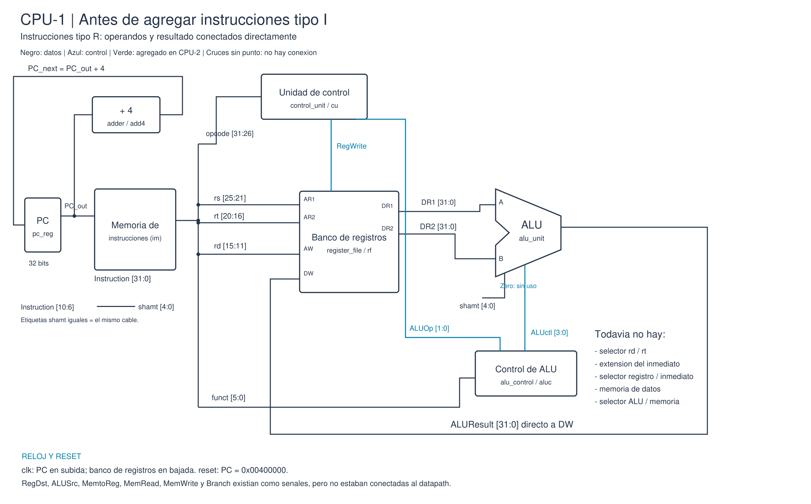
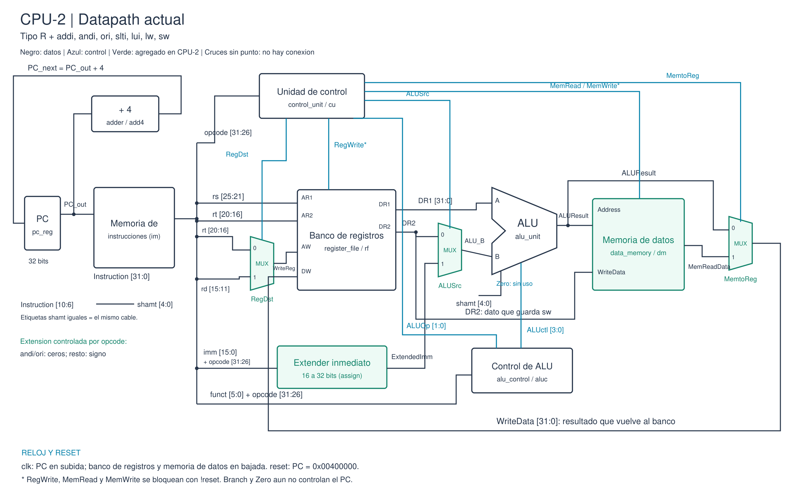

# CPU-2: I-Type Instructions

**Author:** Victor | **Issue:** #5

I extended the existing R-type single-cycle MIPS CPU to support `addi`, `andi`, `ori`, `slti`, `lui`, `lw`, and `sw`. I updated the control unit and ALU control, added the `lui` operation, and connected the destination-register, ALU-operand, and write-back selectors. Immediate values use zero extension for `andi` and `ori`, and sign extension for arithmetic and memory offsets.

I added a 16 KB data memory at `0x10010000`–`0x10013FFF`, with combinational reads, writes on the falling clock edge, and address/alignment checks. Register and memory writes are disabled during reset. The PC still advances by four; branches, jumps, and pipelining are outside this task.

## Before: CPU-1 baseline

The original datapath used `rd` as the destination, `DR2` as the ALU's second operand, and `ALUResult` as the register write-back value.

## After: CPU-2 datapath

The green blocks show the added selectors, immediate extension, and data memory. Blue lines represent control signals. Diagram labels match the Verilog signal names; explanatory annotations are in Spanish.

