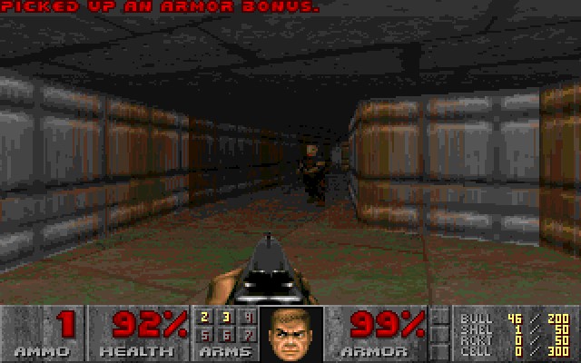

import { Steps } from '@astrojs/starlight/components';
import SystemDiagram from '../../components/SystemDiagram.astro';
import { Image } from 'astro:assets';
import boardTitle from '../../assets/lab/doom-title.jpg';
import boardShooting from '../../assets/lab/doom-shooting.jpg';
import simTitle from '../../assets/evidence/2026-11-23_doom6_title_verilator.png';

:::tip[In 30 seconds]
- Doom runs on **the same CPU and the same `life_system`** as the Game of Life. `top_doom` just turns on two options: video mode B and the external memory.
- Every new piece solves one problem: **it doesn't fit** → SDRAM; **the SDRAM is slow** → caches; **the screen doesn't fit** → a palette; **it's too big to write by hand** → GCC; **the SDRAM can't be preloaded** → a boot loader.
- It **runs on the board**: title screen, demo and a playable game (Nov 26). In simulation it reaches the title screen **1.15 s** after KEY0 and runs the demo at **~7.8 frames per second**.
:::

<figure class="media">
	<video controls preload="metadata" poster="/media/doom-gameplay-pip.jpg" src="/media/doom-gameplay-pip.mp4"></video>
	<figcaption>On the board (Nov 26): from the title screen, through the attract-mode demo and the menus (SW6), to a new game in E1M1. Bottom left: the DE10-Lite at the same moment; every switch movement shows up on screen.</figcaption>
</figure>

## The same system, more pieces

<SystemDiagram />

```verilog
// rtl/top_doom.v
life_system #(.IMEM_INIT("../mem/doom_boot"), .MODE_B(1), .EXT_BUS(1)) sys (...)
```

The Game of Life's top level uses the same module with both options off.

| Problem | Game of Life | Doom | Solution |
|---|---|---|---|
| **1. It doesn't fit** | ~1.3 KB of code, 6 KB of data | 367 KB of code and constants, 300 KB of data, a 6 MB heap and a 4 MB WAD (the game's maps, images and sounds), but the whole FPGA has ~182 KB of memory | The board's **SDRAM**: 64 MB at `0x2000_0000` |
| **2. The SDRAM is slow** | Memory answers in 1 cycle | A load from the SDRAM takes ~8 cycles | The CPU **waits** (`mem_stall`), and two **caches** keep recently used code and data on chip |
| **3. The screen doesn't fit** | 128 × 96, 4 bytes per pixel = 48 KB | 320 × 200 at 4 bytes per pixel would be 256 KB | **Video mode B**: 1 byte per pixel (64 KB) + a 256-color **palette** |
| **4. Too big to write by hand** | ~340 lines of assembly | Tens of thousands of lines of C | **GCC** compiles it; the CPU runs the whole MIPS I integer set |
| **5. Can't be preloaded** | The program is inside the `.sof` | Quartus can't fill the SDRAM | A tiny **boot loader** waits while the PC loads Doom over JTAG |

## 1–2. SDRAM and caches

| Where | Address | What |
|---|---|---|
| On-chip text | `0x0000_0000` | Boot code (`src/doom/boot.S`) |
| SDRAM | `0x2000_0000` | Doom's code, constants and data, then its zeroed data (`.bss`) |
| SDRAM | up to `0x22FF_FFFF` | Heap (`malloc`), ~47 MB |
| SDRAM | `0x2300_0000` | The WAD |
| On-chip data | `0x1001_0000` – `0x1001_3FFF` | Doom's **stack** (1-cycle access instead of ~7) |

The SDRAM is a separate chip, driven by Intel's SDRAM controller (Platform Designer). Our bridge (`rtl/sdram_bridge.v`) turns a CPU load or store into a controller request, holds the CPU with `mem_stall` until it's done, and swaps the bytes (the controller is little-endian, our CPU big-endian).

**Caches.** Programs reuse the same code and data again and again (*locality*), so a small fast copy on chip answers most accesses:

| | Instruction cache (`rtl/icache.v`) | Data cache (`rtl/dcache.v`) |
|---|---|---|
| Size | 8 KB | 16 KB |
| Organization | Direct-mapped, 16-byte lines (4 words) | Direct-mapped, 16-byte lines |
| Hit | 1 instruction per cycle | Answered in the same cycle |
| Miss | Reads the line's 4 words from the SDRAM | Same, ~8 cycles |
| Writes | Code is never written | **Write-through**: every store also goes to the SDRAM |

The data cache almost **doubled** the speed: the demo went from **4.2 to 7.8 frames per second** in simulation. With both caches, `top_doom` uses 8,018 logic elements (16 %), 147 of the 182 memory blocks and has 5.4 ns of setup slack at 25 MHz.

## 3. Video mode B and the palette

Like "paint by numbers": each pixel stores a **number from 0 to 255** (1 byte), and a separate **palette** of 256 entries says which color each number is. The hardware (`rtl/video_mode_b.v`, `rtl/palette.v`) looks up every pixel in the palette on its way to the VGA, doubling it to 640 × 400.

- Pixel (x, y) is the byte at `0x1005_0000 + y × 320 + x`; one `sw` writes 4 pixels (big-endian).
- The palette is at `0x1005_FC00`, one `0x00RRGGBB` word per entry. Doom changes it for effects, like the red flash when the player is hit: no pixel is redrawn.
- The Game of Life does a tiny version of this in software: the board holds 0 or 1, and `draw` turns it into black or white.

## 4. Compiled with GCC

- **doomgeneric** (commit `e257a09`, GPL-2.0): the original Doom source with the platform code separated out.
- **Our platform layer** (`src/doom/doomgeneric_mips.c`): draws Doom's 8-bit frame straight into video mode B, writes its palette, reads the timer and the switches. The same MMIO addresses as the Game of Life.
- **Compiler:** `mips-linux-gnu-gcc` in WSL, a *cross-compiler*: it runs on the PC and produces MIPS code. Flags `-march=mips1 -EB -msoft-float`: MIPS I only, big-endian, no floating-point hardware.
- **Our own minimal C library** (`src/c/libc/`), because the compiler's is built for a different MIPS (with a floating-point unit).
- **ISA check:** the build stops if GCC produced any instruction our CPU doesn't run.
- **Delay slot:** GCC fills every delay slot itself, which is why our CPU [keeps it](/pipeline/#the-branch-delay-slot).

## 5. Booting on the board

<Steps>

1. Program the board with `top_doom.sof`. The CPU starts at `0x0000_0000` in `boot.S`, which just waits for KEY0.

2. From the PC, over the USB cable (JTAG, System Console): load the Doom image at `0x2000_0000` and the WAD at `0x2300_0000` (`src/tools/wad_load.tcl`, which reads both back to check them).

3. Press **KEY0**: `boot.S` jumps (`jr`) to `0x2000_0000` and Doom starts.

</Steps>

The SDRAM loses everything when the power goes off, and so does the FPGA's configuration: after a power cycle, all three steps again. KEY1 resets only the CPU (never the SDRAM controller, which would stop refreshing the memory).

## Controls

| Input | Doom key |
|---|---|
| SW0 / SW1 | Forward / back |
| SW2 / SW3 | Turn left / right |
| SW4 | Run |
| SW5 | Use, open doors |
| SW6 | Enter (menu) |
| SW7 | Escape (menu) |
| SW8 | Strafe (with SW2/SW3) |
| SW9 | Next weapon |
| KEY0 | Fire |

LEDR mirrors the switches Doom reads, so a running Doom and a stuck board look different. To start a game from the title screen: SW6 up and down 4 times (menu → New Game → episode → skill).

## Evidence: simulation and the board

Before going to the lab, Doom ran in **Verilator**, a cycle-accurate simulation of the same RTL and memory map (`make -C verif/verilator doom-check`): its title screen is identical, pixel by pixel, to Doom on the PC. On Nov 26 the same design ran **on the board**, and the image is the same:

<div class="photo-grid not-content">
	<figure>
		<Image src={simTitle} alt="Doom's title screen drawn by our CPU in Verilator" />
		<figcaption>Simulation (Verilator, Nov 23)</figcaption>
	</figure>
	<figure>
		<Image src={boardTitle} alt="Doom's title screen on the VGA monitor, from the DE10-Lite" />
		<figcaption>The board (Nov 26)</figcaption>
	</figure>
</div>

### On the board (Nov 26)

| | Result |
|---|---|
| Doom image and WAD loaded over JTAG | ✅ Both `PASS` (read back byte by byte) |
| Title screen after KEY0 | ✅ First try. Expected ~1.2 s after KEY0 (simulation: 1.15 s); not timed on the board |
| Attract-mode demo | ✅ Runs by itself, choppy but at game speed (simulation: ~7.8 frames per second) |
| Controls (menus, walk, turn, fire) | ✅ All of them worked |
| Restart with KEY1 → KEY0 | ⚠️ Known bug: Doom starts again but the menu doesn't respond. See below |

<figure class="media">
	<Image src={boardShooting} alt="Doom on the monitor: the player fires the pistol in E1M1" />
	<figcaption>Playing E1M1 on the board: KEY0 fires.</figcaption>
</figure>

**Known bug: restarting with KEY1.** After KEY1 and then KEY0, Doom starts again but its menu doesn't respond: it opens, and nothing can be selected. Found in the lab by Victor and Ariel. A full restart works every time: program the `.sof`, load both files and press KEY0.

<figure class="media">
	<video autoplay loop muted playsinline poster="/media/doom-demo.jpg" src="/media/doom-demo.mp4"></video>
	<figcaption>The attract-mode demo on the board: Doom plays a recorded E1M1 session by itself, at about 8 frames per second.</figcaption>
</figure>

Frame 150 of the same demo in simulation, for comparison:


